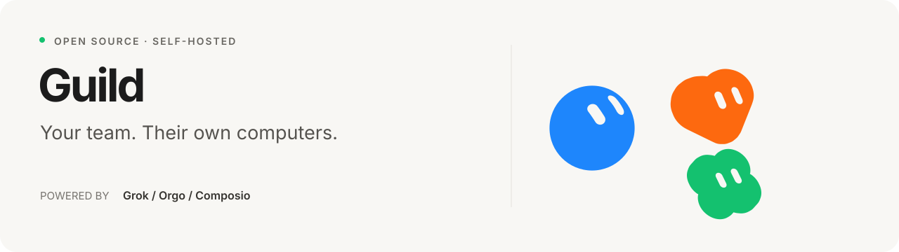

<p align="center">
  
</p>

<p align="center">
  Always-on AI teammates on your own machines.<br>
  One Guildmaster, a shop of specialists, and the API of your choice.
</p>

<p align="center">
  <a href="#quick-start">Quick start</a> ·
  <a href="#what-you-can-do">Features</a> ·
  <a href="#multiple-apis-one-bot-each">Which API each Bot uses</a> ·
  <a href="docs/ARCHITECTURE.md">Architecture</a> ·
  <a href="#credits">Credits</a>
</p>

---

Give a Bot a job, and follow its work in chat. Each Bot has a name, a look, its own memory, its own folder on your computer, and its own model. Bots work together under a **Guildmaster** who can hire specialists, hand out work, and report back in one place.

Guild is a self-hosted clone of the Grok Bot experience. You bring your own API keys; conversations, settings, and agent state live in a local SQLite database on a machine you control.

## What you can do

- **Give every Bot a role.** Instructions, appearance, thinking effort, skills, memories. Make one your Guildmaster.
- **Run the team.** The Guildmaster hires specialists (researcher, writer, analyst, engineer, ops), assigns work, checks progress, and retires Bots that are no longer needed.
- **Work on your own files.** Bots read, write, list, search and run commands on the computer the server runs on. Writes and shell commands ask you first.
- **Spread over several computers.** A tiny agent on each machine registers with the server and runs work there, so a task can be handed to "the laptop" from any chat.
- **Move work through the cloud.** Push a workspace to a synced folder (Google Drive, OneDrive, Dropbox) and pull it down on the other machine.
- **Pick any API per Bot.** MiniMax, Anthropic, DeepSeek, OpenRouter, MiMo, Grok, Ollama or anything OpenAI-compatible — chosen per Bot, not per server.
- **Keep context.** Durable memories, recall, and long-conversation compaction.
- **Routines and events.** Cron schedules, app events, and proactive check-ins from the Guildmaster.

## Which API each Bot uses

Every Bot carries its own provider and model. Open a Bot's settings and pick from the providers the server has keys for; the account default is used until you change it.

```dotenv
LLM_PROVIDER=minimax          # default for Bots that don't choose

MINIMAX_API_KEY=...
MINIMAX_MODEL=MiniMax-M3
ANTHROPIC_API_KEY=...
DEEPSEEK_API_KEY=...
OPENROUTER_API_KEY=...
XAI_API_KEY=...

# Anything else that speaks the OpenAI API (MiMo, a gateway, a local server):
PROVIDERS_JSON=[{"id":"mimo","label":"MiMo","kind":"openai",
  "baseUrl":"https://api.xiaomimimo.com/v1","apiKey":"sk-...",
  "models":["mimo-v2-flash"],"defaultModel":"mimo-v2-flash"}]
```

`kind` is `openai` or `anthropic`. Keys stay on the server; a Bot only stores a provider id and a model name.

## Quick start

### 1. Get the project

Install **Node.js 24 or newer** (Windows, macOS or Linux), then:

```bash
git clone https://github.com/wmehobbs/grokbot-clone.git guild
cd guild
npm install
cp .env.example .env
```

Node 24 is required because the database uses Node's built-in SQLite: no native build step, so the same checkout installs on every machine you use.

### 2. Configure your keys

At minimum, one model provider. See `.env.example` for every option.

```dotenv
LLM_PROVIDER=minimax
MINIMAX_API_KEY=your-key-here
SESSION_SECRET=            # openssl rand -hex 32
DEV_LOGIN=1                # local testing only
```

### 3. Start it

```bash
npm run dev -w server      # API on :8787
npm run dev -w web         # UI on :5173
```

Open **http://localhost:5173**, sign in, and you have a Bot. Create a second, give it a role, and send it work. For a single-process build:

```bash
npm run build
npm start                  # serves the UI and API on :8787
```

## Working on your computer

Give the server the folders Bots may touch:

```dotenv
LOCAL_ROOTS=/path/to/work,/path/to/notes
```

Each Bot also gets its own workspace at `data/workspaces/<user>/`. Bots read and search freely; writes and shell commands raise an approval card first, and you can "always allow" a tool from the same card.

## Several computers

Run the agent on each machine. It has no dependencies beyond Node:

```bash
node machine-agent/agent.mjs
```

```dotenv
# on the other machine
HUB_URL=http://192.168.1.20:8787     # where the server is
MACHINE_NAME=Laptop
MACHINE_TOKEN=...                      # same value as the server's MACHINE_TOKEN
LOCAL_ROOTS=/path/to/work
```

The agent dials the server, so nothing needs to be exposed to the internet; it works over a LAN or Tailscale. Bots then reach it with `machine_list`, `machine_run`, `machine_read_file` and `machine_write_file`.

To carry work from one computer to another, point `CLOUD_ROOT` at a synced folder (Google Drive for Desktop is the usual choice):

```dotenv
CLOUD_ROOT=/path/to/Google Drive/Grokbot
```

and use the `cloud_sync` tool to push or pull a workspace.

## Repo

| Path | What |
|---|---|
| `server/src/llm/` | The provider layer: one interface, many APIs |
| `server/src/agent/` | The turn loop, tools, memory, team management |
| `server/src/machines.ts` | The machine registry and job queue |
| `machine-agent/agent.mjs` | The agent that runs on your other computers |
| `web/src/` | React + zustand UI |
| `scripts/smoke-*.mjs` | End-to-end checks that run against a live server |
| `docs/ARCHITECTURE.md` | How it fits together |

## Development

```bash
npm run typecheck       # server and web
npm run build
node scripts/smoke.mjs            # sign in, create a Bot, get a reply
node scripts/smoke-providers.mjs  # two Bots, two different APIs
node scripts/smoke-team.mjs       # the Guildmaster hires a specialist
node scripts/smoke-local.mjs      # a Bot writes and reads a file on disk
node scripts/smoke-machines.mjs   # a Bot runs a command on another machine
```

## Credits

Guild began as a fork of [nickvasilescu/grokbot-clone](https://github.com/nickvasilescu/grokbot-clone) (MIT), which itself recreates the Grok Bot experience on public APIs. The provider layer, local-machine tools, team management, machine agents and cloud sync in this fork are new work. Upstream copyright and licence notices are kept in `LICENSE` and `THIRD_PARTY_NOTICES.md`.

Not affiliated with xAI. "Grok" and "Grok Bot" are trademarks of their owners; Guild is not a product of xAI.
